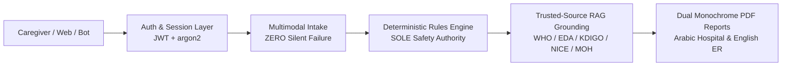

# Sehtak AI v2 (صحتك AI) — Proactive Medical Safety & Triage Guardian

Sehtak AI v2 is an enterprise-grade Medical Safety & Triage system tailored for the Egyptian healthcare ecosystem. It prevents fragmented care and silent drug-induced complications (specifically NSAID-induced nephrotoxicity/acute kidney injury).



## 1. Architectural Invariants
- **INV-1 (Deterministic Primacy):** `DeterministicRulesEngine` is the sole authority for safety alerts, stop orders, and ER escalation. RAG/LLM only explain and cite; they can never downgrade or suppress an alert.
- **INV-2 (Zero Silent Fallbacks):** Any failure in voice transcription or image OCR raises `IntakeDegradationError`, surfaces `degradation: {component, reason}` in the API response, and prompts the user in Egyptian Arabic to provide text input. Empty/default silent triage is strictly forbidden.
- **INV-3 (Verbatim-Verified Citations):** Every clinical claim presented to caregivers or physicians is backed by a verified verbatim quote from trusted medical guidelines (WHO, EDA, KDIGO, NICE, MOH). Unverifiable claims are automatically dropped.

## 2. Ingesting Trusted Sources & Vector Index
To build the hybrid dense (ChromaDB) + sparse (BM25) vector database:
```bash
./.venv/bin/python -m scripts.ingest_sources
```

## 3. Running the Server & API Endpoints
```bash
./.venv/bin/uvicorn app.main:app --host 0.0.0.0 --port 8000 --reload
```

### System Health
```bash
curl -s http://localhost:8000/api/v1/system/health
```

### User Signup & Login
```bash
# Signup
curl -s -X POST http://localhost:8000/api/v1/auth/signup \
  -H "Content-Type: application/json" \
  -d '{
    "email": "caregiver@sehtak.ai",
    "password": "Password123!",
    "full_name": "Ahmed Mansour",
    "role": "caregiver"
  }'

# Login
curl -s -X POST http://localhost:8000/api/v1/auth/login \
  -H "Content-Type: application/json" \
  -d '{
    "email": "caregiver@sehtak.ai",
    "password": "Password123!"
  }'
```

### Case-001 Clinical Triage Analysis
```bash
curl -s -X POST http://localhost:8000/api/v1/triage/analyze \
  -H "Content-Type: application/json" \
  -d '{
    "session_id": "case-001",
    "text_input": "والدتي عندها 65 سنة وعندها ضغط، بتاخد كتافلام 50 ملجم كل يوم بقالها شهرين، وبقالها يومين بتشتكي من وجع في دراعها وهمدان شديد وغممان نفس",
    "reset_session": true
  }'
```
